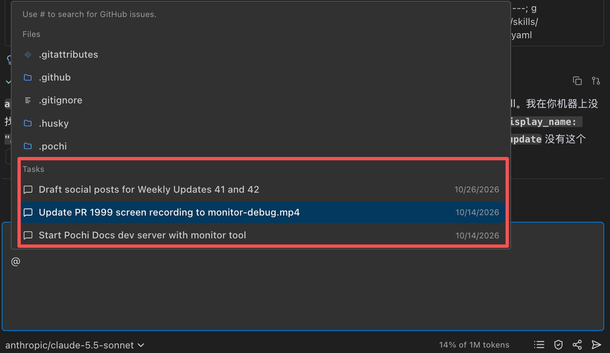

# Weekly Update #44

### TL;DR

Pochi 0.80 shipped on October 28, bringing the task references and inline reviews previewed in our last update to the stable release. Subagents can also work in isolated checkouts, keeping their changes separate from your current workspace. This update makes shared conversations more reliable and helps interrupted tasks recover without getting stuck. Pochi 0.82 is planned for November 9, with background browser work and new ways to connect and delegate tasks already available in the 0.81 prerelease.

More below!

### 🚀 Features

- **Bring an earlier conversation into your next task:** Pick a past task from the composer’s `@` menu to let Pochi read its saved conversation when needed. Carry an investigation or debugging session into the next task without explaining it again, and use the clickable task badge to reopen the original conversation. [**#2011**](https://github.com/TabbyML/pochi/pull/2011)

  

- **Start a review from the code you’re reading:** Select code or right-click a line number, then choose **Pochi: Add Comment**. The comment box opens ready to type, and submitting your first comment starts a review in chat with your feedback tied to those lines. With text selected, you can also use `Cmd+Shift+L` (`Ctrl+Shift+L` on Windows and Linux). [**#2012**](https://github.com/TabbyML/pochi/pull/2012), [**#2030**](https://github.com/TabbyML/pochi/pull/2030)

  <video
    controls
    style={{
      width: "100%",
      borderRadius: "8px",
      boxShadow: "0 4px 12px rgba(0, 0, 0, 0.15)",
    }}
  >
    <source src="https://assets.docs.getpochi.com/comment-review.mp4" type="video/mp4" />
    Your browser does not support the video tag.
  </video>

- **Give subagents their own workspace:** Subagents can now run in separate Git worktrees when isolation is enabled, so they can inspect, test or change code without mixing their edits into your current files. Their checkouts normally start from the repository’s latest default branch, rather than your uncommitted work. Startup fixes also prevent an isolated subagent from getting stuck while its checkout is being prepared. [**#2015**](https://github.com/TabbyML/pochi/pull/2015), [**#2032**](https://github.com/TabbyML/pochi/pull/2032)

  Unused checkouts are cleaned up after the subagent finishes. If a checkout contains changes, it stays available until you archive the parent task. **Before archiving, bring any work you want to keep into another branch or workspace: archiving removes the subagent checkout and its branch, including uncommitted changes.** [**#2035**](https://github.com/TabbyML/pochi/pull/2035)

  > 📷 **MEDIA:** demonstrate an isolated subagent making changes in its own checkout while the main workspace stays unchanged (#2015).

### ✨ Enhancements

- **See when a shared conversation needs to sync:** Large task histories sync more reliably, and the Share menu shows when syncing is still in progress, offline or failing. If there is a problem, **Retry sync** lets you try again from the same menu. [**#2023**](https://github.com/TabbyML/pochi/pull/2023), [**#2029**](https://github.com/TabbyML/pochi/pull/2029)

### 🐛 Bug Fixes

- **Change direction while a tool waits for approval:** Sending a new instruction while a tool awaits manual approval now cancels the pending call and sends your message immediately, instead of leaving it queued behind the approval. [**#2018**](https://github.com/TabbyML/pochi/pull/2018)

- **Recover from interrupted responses:** A model that stops sending data for 60 seconds now produces a visible, retryable error instead of silently stopping the task. If a connection breaks while a tool call is still being generated, **Continue** can resume the task without failing on its incomplete input. [**#2022**](https://github.com/TabbyML/pochi/pull/2022), [**#2033**](https://github.com/TabbyML/pochi/pull/2033)

- **Image-upload failures no longer leave tools spinning:** If an image upload is rate-limited, the tool reports an error rather than staying stuck on “Reading.” Attachment uploads also show a specific rate-limit message. [**#2031**](https://github.com/TabbyML/pochi/pull/2031)

### 👀 Coming Up

The following capabilities are available to try in the [0.81.0 prerelease](https://github.com/TabbyML/pochi/releases/tag/vscode%400.81.0), ahead of the planned November 9 release of Pochi 0.82:

- **Keep working while the Browser Agent runs:** Browser tasks can run in the background while the main conversation continues, with controls to inspect their progress and review the recording afterward. [**#2039**](https://github.com/TabbyML/pochi/pull/2039)

  > 📷 **MEDIA:** show a Browser Agent running alongside the main conversation, then open its progress view (#2039).

- **Let Pochi find relevant earlier work:** Pochi can consult a project’s task-history index and read saved conversations when it needs context from previous work. Task history is available independently of the Project Memory setting. [**#2041**](https://github.com/TabbyML/pochi/pull/2041)

- **Start a separate task without leaving the current one:** When you explicitly ask for a new or separate task, Pochi can open an independent task in its own tab without taking focus away from your current work. It appears in the sidebar and runs separately, rather than returning its result as a subagent response. [**#2044**](https://github.com/TabbyML/pochi/pull/2044)

  > 📷 **MEDIA:** ask for a separate task, show its new background tab, and keep the original conversation in view (#2044).
